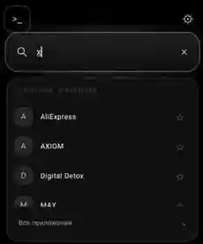
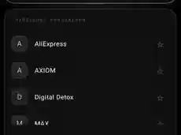

# AXIOM Launcher

## AXIOM 0.20 beta — естественные орбиты, пять моделей вселенной, меньше хаоса

**Новая модель** сохраняет независимые частицы, но улучшает начальные условия и гравитационное удержание. Это **2D модель** со смягчённой самогравитацией, контактами, теплом и отдельным химическим материалом каждого зерна, а не настоящая 3D астрофизическая симуляция.

- **Более плотные тела.** Гравитационная константа выросла с 0.000028 до 0.000052; сглаживание на очень малых расстояниях увеличено, чтобы плотный центр не вызывал бесконечного рывка. Близкие частицы продолжают притягиваться сильнее далёких; сцепление твёрдых материалов и неупругие столкновения переводят случайные движения в тепло, не удаляя песчинки и не фиксируя их в центре.
- **5 выбираемых сцен (Настройки → СЦЕНЫ ВСЕЛЕННОЙ):**
  - Открытый космос: свободные скопления, редкие новые объекты и физические события.
  - Солнечная система: звезда с пятью разными планетами, рассчитанными первоначальными орбитальными скоростями и неодинаковыми составами.
  - Кольца Сатурна: газовый гигант и два спутника плюс 355 (умеренный режим) или 1050 (подробный режим) **реальных ледяных и каменных частиц** в плоском орбитальном кольце. Кольцо движется под гравитацией и не закреплено геометрическим шаблоном.
  - Двойная звезда: два светила на приближённых взаимных орбитах и две планеты.
  - Рождение планет: молодая звезда, зародыши планет и 475/1800 отдельных каменных и силикатных частиц протопланетного диска.
- **Компактные круглые тела с самого начала.** Для каждой планеты используется круговая детерминированная упаковка из частиц с минимальными стартовыми пересечениями; формы не закреплены: позднее реальные столкновения могут их изменять или разрушать.
- **Орбитальная динамика:** начальные тангенциальные скорости рассчитаны из массы звезды/гиганта и той же ближней гравитационной поправки, которую использует решатель. Заданные орбиты — *только начальные условия*, а не анимация по фиксированной траектории. Дальнейшая устойчивость приближённа и зависит от численного интегрирования.
- **Медленнее, подробнее:** сценарии солнечной системы, колец, двойной звезды и рождения планет по умолчанию запускаются на 0,5× игрового времени, увеличивая число подшагов на единицу времени. Пользователь может изменить скорость в настройках. Открытый космос сохраняет исходную скорость.
- **Детали:** звёзды и газовый гигант имеют очень лёгкое световое гало, вычисляемое из реального центра масс видимых песчинок, не декоративную «твёрдую планету». Солнечная система содержит разные материалы (железо, кремний, ледяные породы и летучие газы).
- **Плавность и энергопотребление:** предыдущая 120 Гц интерполяция Canvas, отдельный фоновый расчёт физики 30/60 Гц, пакетная отрисовка, решатель Barnes–Hut, spatial hash и ограничение работы в самых густых ячейках сохранены. Для выбранных сцен в режиме DETAILED создаётся больше настоящих зёрен; потребление ресурсов возрастает. FPS на устройстве не гарантирован.
- **Стабильность сценариев:** автоматические новые объекты извне появляются в открытом космосе и протопланетной сцене. В стабильных орбитальных сценариях внешнее создание массы из событий отключено; существующие физические события и касания по-прежнему могут влиять на орбиты. Переход между сценами сбрасывает только песочницу, а не настройки лаунчера.


## AXIOM 0.19 beta — плотные физические планеты, ежеминутные события, до 120 Гц отрисовки

- **Настоящее ближнее притяжение.** К дереву самогравитации добавлен плавный нелинейный усилитель силы внутри ~0,05 условной единицы; взаимное контактное сцепление твёрдых песчинок увеличено. Это взаимодействие частиц друг с другом, **не закрепление вокруг центрального тела**. Скалы и лёд легче образуют компактные структуры, газ/плазма остаются более свободными.
- **Меньше хаотичного распыления.** Для камня и льда понижена упругость столкновений. Парные тангенциальные импульсы гасят бессмысленную сдвиговую турбулентность, перенося потерянную энергию во внутреннее тепло, сохраняя линейный импульс. Мощный удар всё ещё может разметать планету.
- **Физические события раз в ~60 сек игрового времени:** интервалы между началами обычно 52–68 сек; математика/активные события могут немного сдвигать очередной запуск. Метеоритный дождь вбрасывает **новое вещество извне** в виде 2–3 горячих быстрых физических комков по 26 песчинок; это не вещество, созданное ударом. Пульсары и квазары испускают повторяющиеся направленные струи *из существующего горячего вещества* каждые ~0,7 сек события, расходуя его тепловой запас. Чёрная дыра по-прежнему условный усиленный гравитационный режим существующей массы, а не ОТО.
- **120-герцовая анимация без 120 тяжёлых расчётов.** Физический шаг работает на отдельной корутине с ограничением до 30 Гц для 4800 частиц либо 60 Гц для умеренных сцен; Canvas на поддерживаемом экране делает интерполяцию двух последовательных физических снимков на частоте дисплея **до 120 Гц**. Между физическими шагами показываются промежуточные положения, а не дополнительные симуляции — физическая временная точность от этого не растёт.
- **Границы обещаний:** 120 обновлений экрана не гарантируют 120 FPS на слабых телефонах; замеры GitHub Actions на JVM лишь обнаруживают сильные регрессии. Интерполяция имеет задержку примерно в один физический шаг. На устройствах с 60 Гц отрисовка останется 60 Гц, а экономия батареи может снижать темп.
- **Сохранение:** столкновения и струи не создают атомы; новые частицы могут войти только через границу сцены при внешнем метеорном дожде, редком новом объекте или по пользовательской команде. Тепловая модель условна и при приближённом интегрировании полная энергия может иметь небольшие погрешности.


## AXIOM 0.18 beta — локальная гравитационная связность, разнообразие планет и химия

- Все песчинки независимы. Между **соседними** твёрдыми частицами действует дополнительная взаимная конечнодействующая сила сцепления, рассчитанная как градиент парного потенциала. Силы равны и противоположны: планета может округляться сама, но частицы **не прикреплены к центру и не следуют заданной форме**. Физика газа и плазмы заметно менее связная, для газовых контактов уменьшается жёсткость давления.
- Настоящий круглый *начальный* комок песчинок изредка влетает в сцену из одного из четырёх углов (первый примерно через 46 секунд, далее через 66–122 секунды). Каждый комок содержит 72–105 самостоятельных частиц с одинаковой стартовой скоростью. Это **новая масса извне**, отдельно от событий и столкновений, где число песчинок не меняется.
- **Разные составы:** звёзды по преимущественно водородно-гелиевые, квазары богаче плазмой, облака — летучими газами и льдом; каменные, железные, ледяные и углеродистые планеты получают разные проценты твёрдых веществ. Составы детерминированы и стабильны при одинаковом seed.
- **Редкая модель реакций:** при достаточной температуре и реальном контакте реагируют водород/кислород, железо/кислород, метан/кислород и силикат/железо; суммарная масса и число песчинок неизменны, энергетический баланс учитывает химический потенциал и внутреннее тепло. Это упрощённые *массовые пакеты*, **не стехиометрическая модель атомов**.
- **Новые физические события:** кометный поток, плазменная буря, гравитационная аккреция и кристаллизация. Они меняют существующие частицы и их энергию, но не создают декоративную материю. Чёрная дыра по-прежнему приближённый режим гравитационного взаимодействия, а не общая теория относительности.
- **Производительность:** лимитируем перебор кандидатов в густых клетках, храним таблицу параметров материалов, для очень больших вселенных сокращаем периодичность тяжёлых снимков перемотки (но **не** интеграцию частиц). Тесты отдельно проверяют 4600 песчинок, парное притяжение, сохранение импульса, массу и тепловой баланс реакции.
- Полное сохранение механической энергии лишь приближённое из-за дерева Барнса—Хата, конечного шага интегратора и ограниченного числа обработанных контактов в экстремально плотных областях. Реальная плавность 4500+ зависит от процессора Android; CI на JVM не является замером FPS смартфона.


## AXIOM 0.17 beta — 4600+ песчинок, быстрый расчёт и события из материи

- **Физика по-прежнему у каждой песчинки.** Никаких жёстких планет, декоративных осколков или появления вещества от столкновений.
- **Избавление от главных фризов:** пространственный хеш вместо сетки с зажатыми краями (удалённые песчинки больше не попадают в одну ячейку); ограниченные парные контакты в экстремально плотных областях; ускоренное дерево Барнса—Хата с предвычисленными центрами масс и обходом без рекурсии. Гравитация вычисляется реже, чем контактные силы, начиная с 2800 песчинок.
- **Плавность интерфейса:** физический шаг выполняется в фоновом `Dispatchers.Default`, отрисовка читает только опубликованный неизменяемый снимок, а тысячи точек рисуются в 16 пакетах `Canvas.drawPoints`. Это уменьшает блокировки UI, но не гарантирует конкретный FPS симуляции.
- **Без лишних выделений памяти:** история перемотки сохраняет числовые массивы до 32 снимков вместо множества отдельных объектов.
- **Новые события из песчинок:** метеорный поток, сверхновая, вспышки и каскады расходуют существующий тепловой резерв на импульсы; чёрная дыра усиливает гравитационное взаимодействие *существующего* скопления, сохраняя импульс парных сил. Такие временно меняющиеся поля могут совершать внешнюю работу: строгого сохранения полной энергии во время аномалии нет.
- **Физика фаз вещества:** контактный теплообмен, плавление и замерзание воды, испарение/конденсация, переход водорода в плазму и обратно, плавление силикатов с учётом энтальпии. Стехиометрические реакции пока выключены, поскольку для них нужен отдельный баланс химических элементов.
- **Нагрузочный тест на устройстве:** настройки позволяют явно создать сцену с 4600 частицами и посмотреть время последнего физического шага. Это сознательное добавление вещества по команде пользователя; автоматические события атомов не создают.
- **Регрессионные тесты:** 4620 независимых частиц и 4600 совпавших за границей экрана проверяются в JVM CI на сохранение массы, импульса и ограниченность поиска соседей. Результаты сервера не равны измерению FPS, температуры и расхода энергии на Android.

## AXIOM 0.16 beta — Каждая песчинка живёт по собственной физике

- **Убрано жёсткое закрепление частиц в форме тела.** Теперь одна планета —
  сотни независимых `SandGrain`: собственные координаты, скорость, масса,
  материал и внутренний запас энергии. Ни вращение текстуры, ни
  искусственно заданная окружность не перемещают их.
- **Самогравитация и давление:** все частицы притягиваются друг к другу по
  смягчённому закону обратных квадратов, ускорения аппроксимирует
  дерево Барнса—Хата. Парные контактные силы сопротивляются схлопыванию,
  поэтому шарообразная форма возникает сама при релаксации. Кик-дрифт-кик
  и физические подшаги помогают интегрировать быстрые контакты.
- **Инерционные столкновения:** никаких программных выбросов веером.
  Частицы передают импульс парно. Потерянная при неупругом ударе
  кинетическая энергия записывается как внутренняя (тепло). Количество
  частиц и их массы во время симуляции не меняются; облака могут
  самопроизвольно собраться в новые объекты, оставаясь независимыми
  частицами.
- **Космические события не печатают вещество.** Вспышки/реакции могут
  перераспределять уже накопленную внутреннюю энергию в движение с
  сохранением суммарного импульса. Визуальных осколков без физики нет.
- **Сохранение:** независимые частицы не исчезают из-за возраста и не
  обрезаются границами экрана. Специальные команды явного создания
  объекта добавляют вещество извне — это отдельное осознанное действие,
  в отличие от столкновений и автоматических событий.
- **Качество:** умеренный и проработанный режимы изменяют разрешение
  первоначальной популяции и точность интеграции. Переключение качества
  во время симуляции не создаёт новые частицы. Максимум — 850/4800.
- **Производительность:** пространственная сетка для локальных контактов,
  дерево для гравитации; быстрый пользовательский интерфейс по-прежнему
  приоритетен. Для тяжёлого режима необходимы реальные замеры.

**Честные границы модели:** это упрощённая двумерная гравитационно-
контактная песочница, не точная астрофизика. Дерево Барнса—Хата и
интегрирование с конечным шагом дают численную погрешность энергии.
Упругие силы и тепловая модель условны; химические реакции из
предыдущего прототипа сейчас не интегрированы, пока не реализован
баланс энергии реакций. Внутренняя метка `owner` нужна только для UI
и не фиксирует положение либо скорость песчинок.


## AXIOM 0.15 beta — Космос только из вещества

Новая модель заменяет **все космические силуэты и фоновые эффекты событий** на
отрисовку физических частиц. Бывшие 104 процедурные модели больше не
вызываются из основного Canvas: никаких готовых текстур планет, звёзд или квазаров.

- **Устойчивые структуры:** планеты, газовые облака, звёзды и квазары теперь
  представлены сотнями цветных связанных материальных элементов. Пока структура
  цела, её элементы имеют фиксированные локальные координаты и следуют за
  единым центром масс — это приближение упругого целого тела, а не 100
  независимых гравитационных задач на пиксель.
- **Удары и приливное разрушение:** высокоскоростное столкновение, сильное
  поле соседнего объекта либо событие высвобождают долю *существующей* массы
  вместе с её материалом и импульсом. Небольшие тела могут захватываться
  крупными и сливаться без прежнего ограничения объединённой массы 7 условных
  единиц. Радиус увеличивается вместе с массой.
- **Аккреция:** свободные твёрдые частицы способны формировать новые планеты;
  охлаждённые газовые скопления — облака, которые могут расти и переходить
  в звёзды. Поглощённое вещество добавляется в связанный состав объекта.
- **События:** NOVA, SINGULARITY, SOLAR_FLARE, NEBULA, STELLAR_NURSERY
  и другие сценарии теперь управляют выбросом, вращением, притяжением или
  охлаждением существующего вещества. Старинные гигантские рисованные кольца,
  символьные модели и одноразовые декоративные вспышки отключены.
- **Точное отслеживание массы:** масса связанных частиц уже входит в массу
  объекта и не учитывается при гравитации дважды. При освобождении она
  вычитается из объекта; при поглощении возвращается. Выброс и слияние
  сохраняют массу и суммарный линейный импульс (с округлением Float).
- **Два качества:** умеренный режим ограничивает *свободные* частицы 850,
  детальный — 4800; отдельный адаптивный LOD управляет плотностью
  связанных частиц. Счётчики в настройках разделены.

**Пределы достоверности:** по-прежнему двухмерная качественная модель.
Связанный объект — жёсткое приближение, не SPH-гидродинамика;
нет ядерного синтеза, полноценной стехиометрии, общей относительности
или физически масштабированных астрофизических единиц. События —
художественные аналоги физических процессов. Требуются замеры FPS, памяти
и нагрева на телефоне перед слиянием экспериментальной ветки.


## AXIOM 0.14 (экспериментальная ветка) — Живое вещество

- **Физические частицы вместо декоративной пыли.** При сближении и ударе
  тела отдают часть массы облаку мелких частиц; импульс потока сбалансирован.
  Частицы испытывают притяжение к небесным телам, взаимодействуют с соседями,
  сталкиваются, слипаются и вновь поглощаются телами. При накоплении достаточной
  холодной твёрдой массы появляется новая малая планета.
- **16 типов вещества:** камень, силикаты, железо, углерод, сера, лёд, вода,
  водород, гелий, кислород, метан, пар, плазма, оксид, минерал и стекло.
  У каждого вида свой цвет, газовые свойства и склонность к слипанию.
  Температура управляет плавлением/испарением/замерзанием, а контакты
  некоторых материалов — простыми реакциями.
- **Умеренный** режим: до 850 полноценных частиц, 28 частиц с каждого
  тела при ударе. **Проработанный**: до 4800 частиц, 96 с каждого тела;
  расчёт на 30 Гц с кадровой интерполяцией. Число больших небесных тел
  настраивается отдельно.
- **Настройки:** выбор качества расположен в верхней части раздела физики,
  экспериментальная легенда цветов, статистика, свёрнутые дополнительные
  параметры и подтверждение перезапуска. Выбранный режим сохраняется,
  экспортируется и восстанавливается вместе с остальными настройками.
- **Оптимизация:** соседние частицы ищутся через фиксированную пространственную
  сетку, максимальное число контактов в шаге ограничено, компактирование
  списка частиц выполняется за линейное время. На энергосберегающем режиме
  Android продолжает снижаться частота расчётов.

**Ограничения:** это двумерная художественная симуляция, а не строгая
астрофизика или химический решатель. Упрощённые реакции сохраняют массу
пакетов, но не отслеживают стехиометрию атомов. При заполненном лимите старые пакеты вещества объединяются по близким
ячейкам и типу в более крупные пакеты (LOD), сохраняя массу и импульс,
чтобы освобождать место для новых столкновений.
При уходе частиц за пределы открытого мира их масса покидает сцену.
Проработанный режим может сильно нагревать телефон и расходовать заряд.
Для выпуска нужны замеры FPS/температуры на реальных Android-устройствах.


## AXIOM 0.13 — Многослойная вселенная

Новая версия дополняет 0.12, сохраняя строгую чёрно-белую палитру и
приоритет плавной работы поиска, каталога и терминала.

- **Автоматические темы по своему расписанию.** Настройки → Оформление →
  начало белой и чёрной темы. Интервалы по 15 минут в пределах суток,
  поддерживается переход через полночь. Если время одинаковое, в режиме
  «Авто» используется белая тема весь день.
- **Максимум тел — от 12 до 64.** Реальные тела взаимодействуют по мягкой
  гравитации, настройки сохраняются и экспортируются. При лимите от
  40 тел расчёт работает до 30 Гц с визуальной интерполяцией кадров,
  чтобы не блокировать отзывчивый интерфейс.
- **Режим стен.** Включается в настройках: новые тела по-прежнему влетают
  извне экрана, а при попытке вылететь обратно отражаются с потерей энергии.
  Возраст объектов всё равно ограничен, мир не перенаселяется.
- **Разрушение и объединение.** Каменистые тела могут делиться на 2–4
  самостоятельных осколка. При расколе сохраняются масса и суммарный
  импульс; новые осколки притягиваются и могут слипаться на малой скорости.
  От удара расходятся до 88 косметических пылинок, *не* участвующих в
  вычислениях гравитации. Радиусы объектов растут/уменьшаются в зависимости
  от массы, а не имеют одинаковую физическую величину.
- **Более 100 процедурных силуэтов (104 типа).** Разновидности
  протопланетных дисков, магнитных полей, джетов, линз, галактик, спутников,
  кристаллов, реакционных сетей, плазменных филаментов и других структур.
  Восемь огромных видов могут занимать до половины короткой стороны экрана.
  Они визуально гигантские, но не требуют тысяч отдельных физических частиц.
- **События.** Существующие 18 сценариев дополнились 10 тематическими
  механиками (резонанс, струи, приливный захват, ударные волны, звездорождение,
  перестройка решётки и др.) и четырьмя особенно редкими эпизодами:
  `event mega`, `event merger`, `event void`, `event caustic`.
  Они полностью меняют фон; каждое имеет собственное слабое внешнее
  воздействие на орбиты. Автоматически семь редких событий имеют
  **ровно 7 выигрышных вариантов на 16 384 проверок** (по одному для каждого).
  В терминале их можно вызвать вручную для тестирования.
- **Порядок глубины исправлен.** Математические и ML-визуализации рисуются
  позади космических тел, а поиск, терминал и настройки — поверх всего.
- **Удаление приложений** осталось безопасным: длинное нажатие на программу
  в поиске/каталоге открывает системный диалог Android для подтверждения.
  Системные пакеты через этот пункт не удаляются.

Физика по-прежнему художественная **двумерная** модель, а не точный
астрофизический расчёт; отскоки рассеивают энергию и силы редких событий
внешние. Качество и плавность на конкретном Redmi/HyperOS требуют проверки
на устройстве.


## AXIOM 0.12 · Rare Phenomena

### Что добавлено
- **34 вида объектов:** новые квазары, магнитные петли, спектральные решётки,
  молекулярные облака, звёздные карты и пр. Максимум **23 тела одновременно**,
  чтобы не превращать домашний экран в тяжёлую симуляцию.
- **Три сверхредких события**, меняющих практически всё небо: **Eclipse**
  (гигантское затмение и корона), **Cosmic Web** (сеть тёмной материи),
  **Phase Tide** (волновое искривление пространства). Вероятность 3/4096
  на один выбор космического события; интервал между выборами изменяется,
  поэтому точного расписания нет. В терминале можно посмотреть вручную:
  `event eclipse`, `event web`, `event phasetide`.
- **42 математические модели** с 12 различными визуальными семействами:
  фильтр Калмана, k-means, Монте-Карло, FFT, спектральные графы, стохастические
  блуждания, динамика Хопфилда и другие.
- **15 интерактивных лабораторий:** добавлены настоящие численные
  эксперименты с k-means, фильтром Калмана и броуновской траекторией.
- **Удаление приложений:** удержи приложение в Fluid Index или в поиске,
  затем выбери «Удалить приложение…». AXIOM только открывает системный
  диалог Android, в котором потребуется подтверждение. Системные
  приложения и сам AXIOM защищены от этого действия.

### Что исправлено по результатам аудита
- После изменения списка приложений (в том числе удаления) кэш теперь
  сбрасывается целиком. Исправлен редкий случай устаревшего каталога после
  перезагрузки телефона.
- Физическая система больше не выделяет объекты столкновений для каждой
  пары далёких тел, что снижает нагрузку на сборщик мусора.
- Убрана небезопасная принудительная обработка отсутствующего списка
  недавно запускавшихся приложений.
- Обновление интерактивных лабораторий ограничено 30 Гц; процесс не работает,
  когда лаборатория закрыта. Эффекты космоса не получают доступ к системным
  файлам и не влияют на скорость запуска приложений.

**Проверка на Redmi нужна** для замеров FPS, энергопотребления и работы
системных жестов HyperOS. Редкие события сохраняют чёрно-белую палитру
и не перекрывают поиск или кнопки.


## AXIOM 0.11 · Живая лаборатория

Важное изменение: теперь AXIOM не просто показывает научные анимации —
можно управлять экспериментами, не мешая использованию телефона.

- **Гравитационная кисть:** на пустом рабочем столе удерживай и веди пальцем,
  чтобы воздействовать на окружающие тела. Отпусти после длинного движения —
  появится новый объект с направленной скоростью и попыткой захвата орбиты.
- **Время мира:** пауза, скорости ×0,25, ×0,5, ×1, ×2 и повтор нескольких секунд
  физической симуляции. Время поиска и приложений не изменяется.
- **22 вида процедурных тел:** двойные звёзды, пульсары, геликсы,
  кристаллические решётки, экзопланеты, кривые Лиссажу, спиральные системы и др.
  Одновременно на экране не более 23 тел.
- **Новые космические события:** встреча двух звёзд, волновые кольца,
  излучение, нитевидные структуры и ограниченные цепные реакции.
  Столкновения и слияния зависят от массы и скорости; сохраняются ограничения
  ускорений, числа объектов и потребления ресурсов.
- **30 математических мини-сцен** вместо прежних 16.
- **12 полноэкранных лабораторий** с меняющимися параметрами и реальными
  маленькими численными вычислениями: волны, обучение простого нейрона,
  клеточный автомат Conway Life, Julia, Lorenz, маятник, Fourier,
  attention, градиент, PCA, diffusion и процедурные реакционные узоры.
- **Математические порталы:** настройки → Математические порталы; либо
  дважды нажми на появившуюся формулу; либо команда `lab julia`.
- **Терминал:** `labs`, `lab neural`, `speed 0.5`, `pause`,
  `resume`, `rewind 3`, `spawn binary`, `theme auto`,
  `event reaction` и подсказки команд при вводе.

Численные эксперименты небольшие и образовательные: простая обучаемая
нейронная модель действительно обновляет веса и уменьшает ошибку, но AXIOM
**не обучает большие ML-модели**, не использует облачный сервис и не заменяет
профессиональный научный пакет. Космическая физика остаётся стилизованной 2D.
Научный инспектор и дополнительные журналы космической истории в этой версии
намеренно не добавлялись.


**AXIOM** — минималистичный Android-лаунчер с научной эстетикой, живым космосом и быстрым поиском. Разрабатывается на Kotlin и Jetpack Compose, в первую очередь для Redmi Note 13 Pro 4G (HyperOS).

## Как выглядит

<p align="center">
  
  &nbsp;
  
</p>

*Фрагменты реального скриншота AXIOM 0.9, обрезанные для приватности. В версии 0.10 буквенные заглушки заменены настоящими значками приложений. Белая тема появилась позже этих снимков.*

## Возможности

- **Поиск в центре экрана:** строка раскрывается с мягким свечением. Приложения показываются после начала ввода; есть транслитерация.
- **Настоящие иконки** установленных приложений, асинхронная загрузка и кэш. Если HyperOS не отдаёт иконки сторонней темы, используется стандартный значок Android.
- **Два контрастных оформления:** чёрный космос с белыми объектами и **белый космос с чёрными объектами**. Режим **Авто**: белая тема с 07:00 до 19:00, чёрная — с 19:00 до 07:00 по местному времени телефона.
- **Fluid Index:** быстрый алфавитный список, избранное, недавние приложения и рабочие пространства.
- **Физический космос:** взаимная гравитация, кометы, спутники, волны, редкие аномалии и взаимодействия с касаниями.
- **Математика и ML:** 30 анимированных учебных мини-сцен, пошаговые преобразования формул.
- **Терминал `>_`** для безопасных команд AXIOM, заметок, калькулятора, физических экспериментов и запуска приложений. Это **не** системная Linux-оболочка.
- Резервное копирование настроек и выбор стандартного домашнего экрана через настройки Android.

## Установка

1. Открой вкладку [Actions](../../actions), выбери успешную сборку **AXIOM Debug APK**.
2. Скачай артефакт **AXIOM-optimized-test-APK** (сборка с R8) и установи APK на телефон.
3. Открой AXIOM → настройки → **Выбрать домашний экран** → AXIOM, если HyperOS позволяет выбрать сторонний лаунчер.
4. Чтобы вернуться к Xiaomi: **Настройки Android → Приложения → Приложения по умолчанию → Рабочий стол → System Launcher**.

**Важно:** APK из GitHub Actions подписывается временным тестовым ключом. Перед переустановкой с другой подписью экспортируй настройки, верни стандартный Xiaomi Launcher и удаляй **только AXIOM**. Не трогай системный лаунчер и прошивку.

## Сборка из исходников

Требуются JDK 17, Android SDK 36 и Gradle 8.13.

```bash
bash build-linux.sh
adb install -r app/build/outputs/apk/debug/app-debug.apk
```

Для оценки плавности предпочтительнее оптимизированный APK; сборка Debug может быть медленнее. Настоящую частоту кадров и совместимость жестов HyperOS нужно проверять на устройстве.

## Идеи для будущего

- **Orbital Inspector:** остановка времени в выбранной области и просмотр сил, массы и орбит объектов.
- **Математические эксперименты:** изменять коэффициенты и видеть преобразование формулы и графика.
- **Связанные события:** последствия кометных столкновений и астрофизических аномалий сохраняются в истории мира.
- **Умная контрастность:** автоматическая тонкая настройка толщины линий и плотности звёзд на ярком дневном фоне.

Проект экспериментальный; двухмерная симуляция физически мотивирована, но не является точным трёхмерным астрономическим расчётом.
