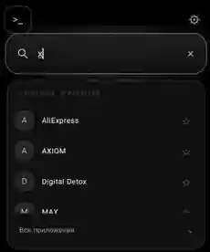
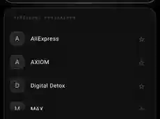

# AXIOM

**AXIOM 0.25 · Android-дом с живой физической обсерваторией.**

Поиск приложений, быстрый доступ к избранному, научные мини-сцены и интерактивная обсерватория — без рекламы, регистрации и сетевых сервисов.

[Kotlin](https://kotlinlang.org/) · [Jetpack Compose](https://developer.android.com/compose) · Android 8.0+ (API 26) · Open source

---

## Как выглядит

<p align="center">
  
  &nbsp;
  
</p>

*Реальные фрагменты экрана AXIOM 0.9, опубликованные без личных данных. Они показывают устройство поиска, но **не отражают интерфейс версии 0.24**. Актуальные полноразмерные скриншоты нужно снять на устройстве перед стабильным релизом.*

## Обновление 0.25 · Living Cosmos

- **Живые цивилизации**: ресурсы, переселение, настоящие полёты, риск вымирания и попытки перехвата астероидов.
- **Чёрные дыры и звёздные остатки**: поглощение существующего вещества, аккреционные диски, нейтронные звёзды и белые карлики.
- **Очень редкие катастрофы**: гамма-всплески, далёкие кластерные взрывы, килоновые, сверхновые и огромные астероидные потоки.
- **Физические цифры часов**: контур из того же изображения, которым рисуется время; границы почти у краёв всего экрана.
- **18 сценариев, 20 рецептов объектов**, почасовая смена систем и палитры, квантовый эксперимент и обучение для выживания/навигации.

[Как это работает и что настроить](docs/LIVING-COSMOS-025.md).

## Основа 0.24

Новый домашний экран с часами, избранным и нижней навигацией. Спокойная палитра, мягкие переходы и обсерватория из четырёх разделов: **Сцены · Объекты · Наука · Среда**.

- 12 начальных сценариев: к прежним системам добавлены резонанс 1 : 2 : 4, комета, троянские тела, звезда-странник, косой удар и холодный диск.
- 12 рецептов объектов, выбор точки появления, массы и начальной скорости.
- Согласованный интегратор kick–drift–kick, взаимные приливные силы и вязкий нагрев с сохранением вращения.
- Следы орбит, векторы скорости, диагностика вещества и приближённые орбитальные элементы.
- Локальная ML-регрессия оценивает G по наблюдениям и показывает ошибку следующего прогноза.
- Настраиваемые случайные события, спокойный режим, математические этюды и сохранение новых параметров в резервной копии.

[Подробности реализации, ограничения и проверки](docs/OBSERVATORY-024.md).

## Что умеет

**Лаунчер**
- Быстрый поиск установленных приложений с поддержкой русских названий и транслитерации.
- Каталог (Fluid Index), избранное, история недавно открытых приложений и рабочие пространства.
- Светлая, тёмная и автоматическая темы. Градиентная поисковая панель и мягкое свечение активного поля.
- Настоящие иконки приложений, асинхронная загрузка и кэш.
- Встроенный безопасный терминал и калькулятор. Терминал не исполняет системные shell-команды.

**Физическая обсерватория**
- Кнопка **Космос** на главном экране открывает панель управления космосом.
- Создание объектов из реальных песчинок: каменная/железная/ледяная планета, газовый мир, звезда, квазар, магматический или органический мир.
- Изменение массы перед созданием, физические импульсы, пауза и воспроизведение.
- Случайные и вручную вызываемые события четырёх уровней силы, от небольших до катастрофических.
- 12 начальных сцен, включая: открытый космос, солнечная система, кольца Сатурна, двойная звезда, протопланетный диск, система титанов и карликов.

**Наука и оформление**
- 42 математические темы с собственными формулами и поэтапными преобразованиями.
- Уникальная геометрия для фракталов, аттрактора Лоренца, маятника, L-систем, FFT, оптического потока, диаграмм Вороного и других моделей.
- Астрономическая фоновая подсветка по положению настоящих звёзд, без фиктивных материальных песчинок.
- 23 типа вещества, упрощённые химические реакции, температура, столкновения и самогравитация.

## Физика: что моделируется

Движок `AstronomicalUniverse` использует **два масштаба**: межпланетное притяжение рассчитывается по центрам масс реальных скоплений, внутри каждого скопления интегрируются независимые песчинки с координатами, скоростью, массой, теплообменом и контактом. Свободная пыль может сближаться, слипаться или уходить с орбиты.

Это визуальная **2D-модель** с эффективными физическими законами, а не точный трёхмерный N-body, MHD или реактор термоядерного синтеза. Реализм ограничен ради удобной и быстрой интерактивной симуляции. В подробном режиме — до 4800 физических частиц. Интерполяция изображения может идти с частотой дисплея до 120 Гц, физика интегрируется фиксированными квантами 1/60 секунды в отдельном рабочем цикле; реальный FPS зависит от телефона.

## Установка на Android

**Требования:** Android 8.0 или новее (API 26), телефон или планшет с поддержкой сторонних домашних экранов.

1. Открой [GitHub Actions](https://github.com/Mobzya/AXIOM-launcher/actions/workflows/build-apk.yml), выбери успешную сборку и скачай артефакт `AXIOM-optimized-test-APK`.
2. Извлеки APK из ZIP и установи его на Android. При необходимости разреши установку из выбранного браузера или файлового менеджера.
3. Открой AXIOM → Настройки → **Выбрать домашний экран**. Выбери AXIOM в системных настройках домашних приложений.
4. Чтобы вернуться к прежнему лаунчеру, выбери его в Android → Настройки → Приложения → Приложения по умолчанию → Домашнее приложение (названия меню отличаются у производителей).

На Pixel, Samsung Galaxy, OnePlus, Xiaomi/Redmi/POCO и других системах возможность заменить домашний экран определяется **производителем и настройками Android**. Жесты навигации, недавние приложения, ограничения фоновой активности и поведение анимаций могут отличаться. AXIOM не требует root, ADB-прав или удаления системного лаунчера.

**Важно о подписи:** сборки из Actions используют тестовый/debug-ключ. Это предварительные сборки, не стабильный релиз с постоянной подписью. Перед переустановкой другой подписи экспортируй настройки в AXIOM; Android не всегда разрешает обновление поверх приложения с другим ключом. Системный лаунчер удалять нельзя.

## Сборка из исходников

JDK 17, Android SDK 36, Gradle 8.13. Все APK из CI — тестовые сборки с debug-подписью.

```bash
bash build-linux.sh
adb install -r app/build/outputs/apk/debug/app-debug.apk
```

Результаты unit-тестов и нагрузочных испытаний собираются автоматически в [CI](https://github.com/Mobzya/AXIOM-launcher/actions/workflows/build-apk.yml). Цифры из GitHub Actions на JVM **не равны FPS на реальном Android**.

## Планы для стабильного релиза

- Проверить работу выбора домашнего экрана, жестов, поиска и иконок на устройствах разных производителей.
- Записать современные скриншоты главного экрана и обсерватории и дополнить ими галерею выше.
- Настроить **постоянный приватный ключ подписи** для совместимых обновлений APK.
- Подготовить подписанный Android App Bundle и отдельную политику публикации, если проект пойдёт в магазин приложений.

## Исходный код и обратная связь

[Issues](https://github.com/Mobzya/AXIOM-launcher/issues) · [Pull requests](https://github.com/Mobzya/AXIOM-launcher/pulls) · [Сборки](https://github.com/Mobzya/AXIOM-launcher/actions)

В отчёте об ошибке укажи версию Android, модель устройства, версию AXIOM, способ установки и шаги воспроизведения. Для лагов особенно полезны настройки частоты экрана и режима энергосбережения.

AXIOM создаётся как самостоятельный домашний экран для Android, а не оболочка конкретной модели Redmi.
